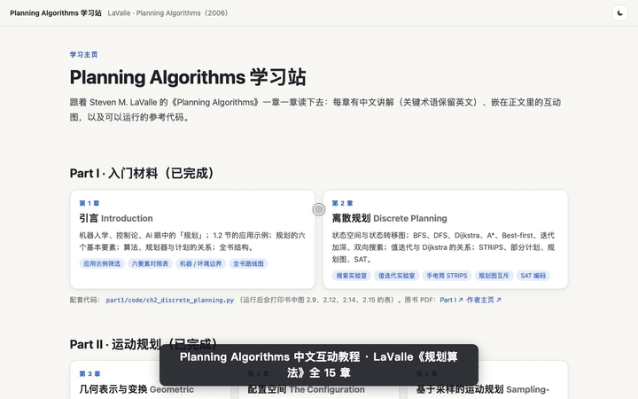

# Planning Algorithms 中文互动教程 · LaValle《规划算法》Interactive Tutorial

跟着 Steven M. LaValle《Planning Algorithms》（中文常译《规划算法》，Cambridge University Press, 2006）逐章学习的中文教程，共 15 章。内容覆盖离散规划、配置空间、基于采样的运动规划（RRT、PRM）、组合运动规划、反馈运动规划、决策论与 MDP、传感器与信息空间、微分约束与非完整系统。每章都有中文讲解（关键术语保留英文）、嵌在正文里的可交互图，以及可以运行的 Python 参考实现。原书全文免费：<https://lavalle.pl/planning/>

**English:** An interactive, chapter-by-chapter Chinese tutorial for Steven M. LaValle's *Planning Algorithms*. It covers all 15 chapters (motion planning, configuration space, sampling-based planning with RRT/PRM, combinatorial planning, feedback planning, decision theory, information spaces, differential constraints). There are 200+ in-browser interactive figures and Python reference implementations. It is a pure static site with no build step.

- **在线阅读 / Live site**：<https://xpengzxp.github.io/lavalle-planning-algorithms-zh/>
- 仓库：<https://github.com/xpengzxp/lavalle-planning-algorithms-zh>
- 入口：仓库根目录的 [`index.html`](index.html)，也就是学习主页，有每章卡片、全书路线图和「我已读完」勾选。每个章节页的顶栏都能回到主页。

## 使用演示



上面的动画大约 55 秒，依次演示：

1. 主页上的章节卡片；
2. 切换深色和浅色；
3. 在全书路线图里点一章，查看它的前置章节和后续章节；
4. 勾选「我已读完」，进度只存在自己的浏览器里；
5. 进入第 6 章，用左侧目录跳转，切换互动图的模式；
6. 回到主页，看进度条更新。

清晰版视频：[`docs/demo/how-to-use.mp4`](https://xpengzxp.github.io/lavalle-planning-algorithms-zh/docs/demo/how-to-use.mp4)，在浏览器里直接播放。

## 怎么阅读

全站是纯静态网页（HTML/CSS/JS），没有构建步骤。

- **在线阅读**：<https://xpengzxp.github.io/lavalle-planning-algorithms-zh/>，由 GitHub Pages 从 `main` 分支根目录部署。
- **下载到自己电脑**：

  ```bash
  git clone https://github.com/xpengzxp/lavalle-planning-algorithms-zh.git
  cd lavalle-planning-algorithms-zh
  python3 -m http.server 8765
  ```

  然后在浏览器打开 <http://localhost:8765/>。
- 公式（KaTeX / MathJax）和字体从 CDN 加载，需要联网。

## 阅读进度只保存在你自己的浏览器里

「我已读完」的勾选保存在当前浏览器的 `localStorage` 里（键 `pa-progress`）：

- 每位读者、每个浏览器的进度都是独立的，不会上传，也不会写进仓库。别人打开时看到的是他自己的进度，一开始全部是空的。
- 换浏览器、换电脑、用无痕窗口，或者清除浏览器数据之后，进度会从零开始。
- 在线版（github.io）和下载到本地运行的版本是不同的网址，两边的进度也互不相通。
- 深浅色设置同样只存在浏览器里（键 `pa-theme`）。

## 目录

```
lavalle-planning-algorithms-zh/
├── index.html          学习主页（所有章节从这里进入）
├── README.md           本文件
├── CLAUDE.md           编写约定与「新增一章」流程（给 Claude 会话看）
├── LICENSE             MIT 许可证
├── docs/
│   ├── demo/           使用演示（how-to-use.gif / .mp4）
│   └── COORDINATION.md 第 6–15 章云端会话的协调记录
├── assets/             共用样式与脚本：style.css、common.js、roadmap.js（章节登记表）
├── part1/              Part I   入门材料          第 1–2 章
├── part2/              Part II  运动规划          第 3–8 章
├── part3/              Part III 决策论规划        第 9–12 章
└── part4/              Part IV  微分约束下的规划  第 13–15 章
    每个 partN/ 里：chK-<slug>.html 是章节页，js/chK-*.js 是该章的互动组件，code/chK_*.py 是参考实现
```

原书 PDF 版权属于 Cambridge University Press，不放进仓库。页面里的原书链接都指向 <https://lavalle.pl/planning/>。

## 章节

| 章 | 标题 | 入口 |
|---|---|---|
| 1 | 引言 Introduction | [part1/ch1-introduction.html](part1/ch1-introduction.html) |
| 2 | 离散规划 Discrete Planning | [part1/ch2-discrete-planning.html](part1/ch2-discrete-planning.html) |
| 3 | 几何表示与变换 Geometric Representations and Transformations | [part2/ch3-geometric-representations.html](part2/ch3-geometric-representations.html) |
| 4 | 配置空间 The Configuration Space | [part2/ch4-configuration-space.html](part2/ch4-configuration-space.html) |
| 5 | 基于采样的运动规划 Sampling-Based Motion Planning | [part2/ch5-sampling-based-planning.html](part2/ch5-sampling-based-planning.html) |
| 6 | 组合运动规划 Combinatorial Motion Planning | [part2/ch6-combinatorial-motion-planning.html](part2/ch6-combinatorial-motion-planning.html) |
| 7 | 基本运动规划的扩展 Extensions of Basic Motion Planning | [part2/ch7-extensions-of-basic-motion-planning.html](part2/ch7-extensions-of-basic-motion-planning.html) |
| 8 | 反馈运动规划 Feedback Motion Planning | [part2/ch8-feedback-motion-planning.html](part2/ch8-feedback-motion-planning.html) |
| 9 | 基本决策论 Basic Decision Theory | [part3/ch9-basic-decision-theory.html](part3/ch9-basic-decision-theory.html) |
| 10 | 序贯决策论 Sequential Decision Theory | [part3/ch10-sequential-decision-theory.html](part3/ch10-sequential-decision-theory.html) |
| 11 | 传感器与信息空间 Sensors and Information Spaces | [part3/ch11-sensors-and-information-spaces.html](part3/ch11-sensors-and-information-spaces.html) |
| 12 | 感知不确定下的规划 Planning Under Sensing Uncertainty | [part3/ch12-planning-under-sensing-uncertainty.html](part3/ch12-planning-under-sensing-uncertainty.html) |
| 13 | 微分模型 Differential Models | [part4/ch13-differential-models.html](part4/ch13-differential-models.html) |
| 14 | 微分约束下的采样规划 Sampling-Based Planning Under Differential Constraints | [part4/ch14-sampling-based-planning-under-differential-constraints.html](part4/ch14-sampling-based-planning-under-differential-constraints.html) |
| 15 | 系统理论与解析方法 System Theory and Analytical Techniques | [part4/ch15-system-theory-and-analytical-techniques.html](part4/ch15-system-theory-and-analytical-techniques.html) |

## 参与修改

修改或新增内容前请先读 [`CLAUDE.md`](CLAUDE.md)，里面规定了文件放在哪里、怎么登记到主页和路线图，以及页面写法。提交后检查：主页卡片能点进去、路线图可点击、章节页顶栏能回首页、深浅色一致、浏览器控制台没有报错。

## 许可证

本仓库的讲解文字、互动图代码和参考实现采用 [MIT 许可证](LICENSE)。原书《Planning Algorithms》的版权归 Steven M. LaValle 和 Cambridge University Press 所有，本仓库不包含原书 PDF，页面里只链接到作者主页。
